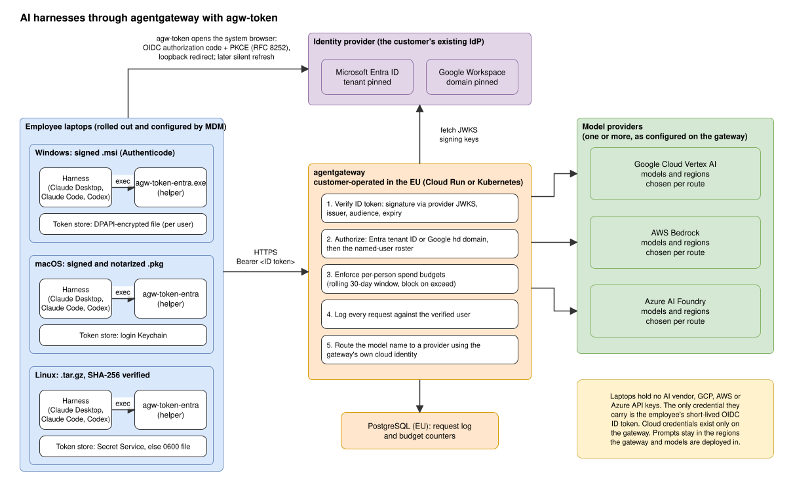

# Compliance overview

How AI harnesses are deployed on employee laptops with model traffic routed through a
self-operated [agentgateway](https://agentgateway.dev), with `agw-token` signing employees
in through the organization's existing identity provider.

A *harness* is the AI assistant application the employee works in: Claude Desktop,
Claude Code, Codex (each as a desktop app, terminal tool or IDE extension) or any other
tool that can run a command to obtain its credential.
Harnesses differ in features, but in this setup they all behave the same way: they send
prompts to the gateway and get their credential from `agw-token`. The rest of this
document says "harness" for any of them.

## Summary

- Employees use their harness as normal, but with no vendor API key. `agw-token` signs
  them in with their corporate account (Microsoft Entra ID or Google Workspace) and
  hands the harness a short-lived OpenID Connect ID token.
- Every model request goes over HTTPS to the organization's agentgateway with that token.
  The gateway verifies it, checks the user belongs to the organization and is on an
  explicit roster, enforces a per-person spend budget, logs the request against the user
  and forwards it to the model provider.
- Only the gateway holds cloud credentials. It forwards to models on the organization's
  own cloud account (Google Cloud Vertex AI, AWS Bedrock or Azure AI Foundry) in
  regions the organization chooses. Changing provider or model changes nothing on the
  laptops.
- No new accounts, passwords or API keys are created. Access is granted and revoked in
  the identity provider and the gateway roster.

## Components

| Component | Runs on | Role |
|---|---|---|
| Harness (Claude Desktop, Claude Code, Codex, ...) | Employee laptop | The AI assistant application. Sends prompts, including file contents and tool output, to the gateway. |
| `agw-token` (this repository, MIT) | Employee laptop, installed by MDM | Obtains, stores and refreshes the employee's ID token. Open source; runtime dependencies are the Go standard library and `golang.org/x` only. |
| Identity provider | Entra ID or Google Workspace | Authenticates the employee with the organization's normal MFA and Conditional Access policies. |
| agentgateway (open source) | Cloud Run or Kubernetes, organization's cloud | Verifies tokens, authorizes, budgets, logs, routes to models. |
| PostgreSQL | Same region as the gateway | Request log and budget counters. |
| Model provider | Vertex AI, Bedrock or AI Foundry | Inference under the organization's own contract with that cloud provider. |

## How it works

1. **First sign-in.** The harness runs `agw-token`, which opens the system browser at the
   identity provider (OAuth 2.0 authorization code with PKCE, loopback redirect, RFC
   8252). The employee signs in as for any other corporate app. `agw-token` exchanges
   the code directly with the provider over TLS, validates the ID token's issuer,
   audience, expiry and nonce, and stores the tokens in the OS secret store.
2. **Every later request.** The harness caches the token for a few minutes, then asks
   again. `agw-token` prints the stored token while it is valid (no network access), or
   refreshes it silently. The browser only reopens if the refresh fails, for example
   because the account was disabled.
3. **At the gateway.** Signature checked against the provider's published keys, then
   issuer, audience and expiry; then organization membership (Entra tenant ID, or
   Google hosted domain with `email_verified`); then the user roster; then the budget.
   The request is logged and forwarded with the gateway's own cloud identity.

## Why not static API keys

A long-lived API key on every laptop is a secret to distribute, store and rotate, works
for anyone who copies it until someone notices, and names a key rather than a person
in the logs. Here there is no secret to distribute: the employee signs in with their
normal account, the token expires after about an hour, every request is attributed to a
person, and access is revoked by disabling the account. MFA, Conditional Access and
joiner/leaver processes apply unchanged, and the cloud credentials never leave the
gateway.

## Controls

- **Authentication** is entirely the identity provider's. The helper never sees
  passwords or MFA. Disabling the account stops token refresh; access ends when the
  current token expires (about an hour). Removing the roster entry is immediate.
- **Credentials on the laptop** are the employee's own ID and refresh token, per user,
  in the OS secret store: DPAPI-encrypted file on Windows, login Keychain on macOS,
  Secret Service on Linux (0600 file where no keyring exists). No cloud or AI vendor
  keys exist on laptops. The helper contacts only the identity provider, sends no
  telemetry, and never prints a token in status output.
- **Shared public clients.** For a quick start the helper can use the Azure CLI or
  gcloud public client, so anyone with those CLIs can get a token with the same
  audience. The gateway's tenant/domain pin and roster are therefore mandatory. For
  production, register an organization-owned client; it gets its own Conditional
  Access policies and a unique audience.
- **Data residency.** Prompts travel laptop, gateway, model provider, over TLS, within
  the regions the gateway and models are deployed in. The organization decides those
  regions: the gateway configuration names the region for every model route, so it can
  for example be limited to EU regions only, and the cloud account's own policies can
  enforce the same limit (Google Cloud resource location constraints, AWS Organizations
  region restrictions, Azure Policy allowed locations) so nobody can deploy a route
  elsewhere by mistake. The provider's handling of prompts (training use, retention,
  abuse monitoring) is governed by the organization's contract with that cloud: see
  [Vertex AI](https://docs.cloud.google.com/vertex-ai/generative-ai/docs/data-governance),
  [Bedrock](https://docs.aws.amazon.com/bedrock/latest/userguide/data-protection.html) or
  [Microsoft Foundry](https://learn.microsoft.com/en-us/azure/foundry/responsible-ai/openai/data-privacy).
  This setup adds no processor of its own.
- **Logging and budgets.** Each request is attributed to the verified user and group with
  model, token counts, cost and time. Budgets are per person over a rolling 30-day
  window and block when exceeded. The gateway UI is OIDC-protected and read-only;
  configuration and the roster are version-controlled files. Whether prompt and
  response bodies are retained is a separate gateway setting; decide and record it.
- **Supply chain.** Releases are built by CI from a tagged commit, Authenticode-signed
  for Windows (`.msi`), Developer ID-signed and notarized for macOS (`.pkg`), and
  attested with GitHub build provenance. Linux and Windows builds are reproducible from
  source. Deployed and updated by MDM, with machine-wide configuration pinned by an
  administrator-owned file. See [DEVELOPMENT.md](DEVELOPMENT.md#verifying-a-release-against-the-source).

## Harness updates

The gateway and helper control model access, not the harness binaries. Each harness
has its own update path, and the organization should decide for each one whether MDM
or the vendor's updater owns the installed version. Status at the time of writing:

| Harness | Default behavior | Enterprise control |
|---|---|---|
| Claude Desktop | Checks for updates about every 4 hours and installs them itself. Also downloads a private copy of Claude Code from `downloads.claude.ai`. | Managed setting `disableAutoUpdates` lets MDM own the version (Windows registry under `HKLM\SOFTWARE\Policies\Claude`, macOS profile for `com.anthropic.claudefordesktop`, Linux managed settings file); `autoUpdaterEnforcementHours` bounds the forced restart. MSIX on Windows, signed app bundle on macOS. |
| Claude Code | The native install updates itself in the background from `downloads.claude.ai`. Homebrew, WinGet, apt, dnf and apk installs do not. | Managed settings `autoUpdatesChannel` (`stable` or `latest`), `minimumVersion`, `requiredMinimumVersion` and `requiredMaximumVersion`; `DISABLE_AUTOUPDATER` or `DISABLE_UPDATES` when the organization distributes the binary. Releases have a GPG-signed manifest, Apple and Authenticode code signatures, and signed Linux package repositories. |
| Codex CLI | Does not update itself. Updated by rerunning the installer or the package manager (npm, Homebrew, WinGet). | The installed version is what MDM or the package manager put there. OpenAI's deployment guide pins it with the installer's `-Release` flag or an explicit npm version, packaged as an Intune Win32 app on Windows. |
| Codex app (part of the ChatGPT desktop app) | Built-in updater checks and installs on its own, downloading from `persistent.oaistatic.com`. On Windows the Microsoft Store or Intune can update it as well. | Managed configuration `in_app_updates = false` under `[features]` in `requirements.toml` (`/etc/codex/requirements.toml`, `%ProgramData%\OpenAI\Codex\requirements.toml`, or the `com.openai.codex` macOS profile) turns the updater off. OpenAI offers no version pinning, so MDM or the Store then owns the version. |
| Claude Code VS Code extension | Bundles its own copy of Claude Code; the extension version is the Claude Code version. Updated by VS Code's extension auto-update from the Marketplace. | Reads the same `~/.claude/settings.json` and managed settings as the CLI, so the gateway and helper configuration applies unchanged. Version and updates are governed by VS Code's own policies, below. |
| Codex VS Code extension | Updated by VS Code's extension auto-update from the Marketplace. | Shares the configuration layers of the CLI (`config.toml`, `requirements.toml`), so the same managed configuration applies. Governed by VS Code's policies, below. |
| `agw-token` | Never updates itself and contacts nothing but the identity provider. | MDM pushes the signed `.msi` or `.pkg`; see Supply chain above. |

The managed settings that carry the gateway and helper configuration reach every
surface of a harness. Claude Code reads them from `managed-settings.json` in a system
directory, a `com.anthropic.claudecode` macOS profile or the `HKLM\SOFTWARE\Policies\ClaudeCode`
registry key, and applies them in the terminal, the VS Code and JetBrains extensions and
the desktop app's Code tab. Codex reads `requirements.toml` from `/etc/codex`,
`%ProgramData%\OpenAI\Codex` or the `com.openai.codex` profile in the CLI and the IDE
extension alike.

The IDE extensions themselves are governed by VS Code's enterprise policies, delivered
by Group Policy or Intune (registry key `Software\Policies\Microsoft\VSCode`), a macOS
configuration profile, or `/etc/vscode/policy.json`: `AllowedExtensions` limits which
extensions may be installed, `ExtensionsAutoUpdate` and `ExtensionsAutoUpdateDelay`
control extension updates, `ExtensionGalleryServiceUrl` can point at a private gallery,
and `UpdateMode` controls VS Code's own updates.

Update checks and telemetry go to the vendor directly, not through the gateway. Allow or
restrict that egress deliberately, and treat the harness like any other endpoint software
in the patch process.

## Risks

| Risk | Mitigation |
|---|---|
| Any Azure CLI or gcloud user could reach the gateway | Tenant/domain pin and roster on the gateway; own client for production. |
| Refresh token stolen from a laptop | OS secret store, MDM-managed encrypted disks, identity-provider session policies; disable the account to cut refresh. Same exposure as any other OIDC session on the laptop. |
| Employee calls the gateway outside the harness (e.g. `curl`) | By design; roster, budget and logging apply regardless of client. |
| Sensitive data in prompts | Reaches only the organization's gateway and cloud provider; set usage guidance and decide on body logging. |
| Gateway outage | Stateless instances share the database; run more than one. Affects only the harnesses. |
